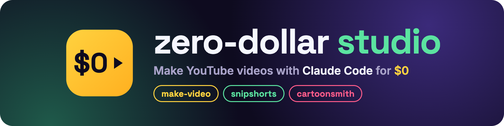
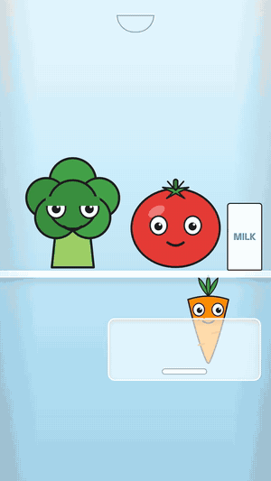
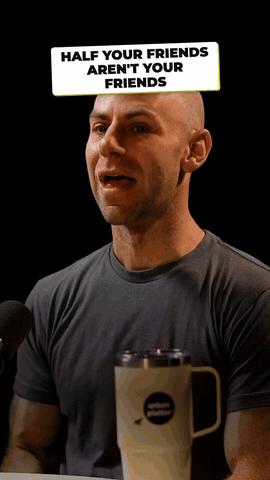
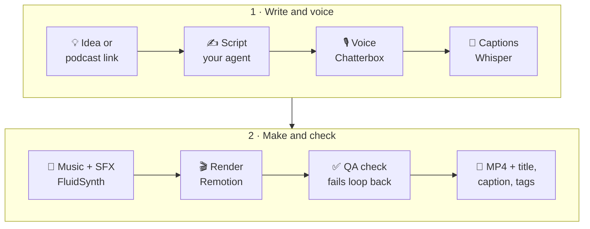

<p align="center">
  
</p>

<p align="center">
  <a href="https://github.com/TheNoumanDev/zero-dollar-studio/releases"></a>
  <a href="LICENSE"></a>
  <a href="guides/LICENSE"></a>
  
  
  <a href="CONTRIBUTING.md"></a>
  <a href="https://www.youtube.com/channel/UC2ahNqB5F_pp16O27rmlMtA"></a>
</p>

<p align="center">
  <b>Script, voice, captions, music, animation and QA, made by free local tools and driven by Claude Code skills.</b><br>
  No subscriptions, no credits, no API keys, no watermark.
</p>

## 🎬 Watch it in action

<p align="center">
  <a href="https://www.youtube.com/watch?v=CKhU8AHQ6N4">
    
  </a>
  <br>
  <sub>▶ <a href="https://www.youtube.com/watch?v=CKhU8AHQ6N4"><b>I make these AI videos for $0: my full free stack, explained</b></a> · <a href="https://www.youtube.com/shorts/1wMujOBFRD4">Short version</a><br>
  The script, voice, captions, music and edit were made with these skills; the AI face step lands in make-video v0.2.</sub>
</p>

<table>
  <tr>
    <td width="300" align="center">
      
    </td>
    <td>
      <h3>What you get on day one</h3>
      <p>Install the plugin and ask for a video. Claude checks your Mac, lists what it needs to download, and waits for your OK. Then it sets everything up and renders <b>Fridge Drama</b>: 33 seconds of three vegetables arguing in a fridge, with voices, word-synced captions, music and SFX, all generated on your laptop.</p>
      <p>Then you ask for your own: <i>"make a 30-second Short explaining how DNS works"</i>. Claude writes the script, checks its facts, voices it, captions it, scores it, renders it and runs a QA check on the result.</p>
    </td>
  </tr>
</table>

## 🖼️ Made with it

Real Shorts from the channels these skills were built for, straight from the render folder.

<table>
  <tr>
    <td align="center" width="33%">
      <br>
      <b>🎨 cartoonsmith</b><br>
      <sub>Super Sharma Parivaar: rigged characters, lip sync, Hinglish captions</sub>
    </td>
    <td align="center" width="33%">
      <br>
      <b>✂️ snipshorts</b><br>
      <sub>A TV episode → a vertical Short: hook title, captions, "how it started" rewind</sub>
    </td>
    <td align="center" width="33%">
      <br>
      <b>✂️ snipshorts</b><br>
      <sub>A 2-hour podcast → the best minute, speaker tracked, captions</sub>
    </td>
  </tr>
</table>

<sub>Clips shown as short demos of the output. Bigg Boss 20 © Colors TV / JioHotstar. Adam Grant on <a href="https://www.youtube.com/watch?v=khp7AnOJn8g">Figuring Out with Raj Shamani</a>. Only clip what you have the rights to post.</sub>

## 💸 Why not just pay for it?

Doing the same with paid tools costs about **$50 a month**, and the free tiers stamp a watermark on your videos.

| You'd normally pay for | Paid tool (cheapest plan) | Here |
|---|---|---|
| Podcast → Shorts clipping | OpusClip: $15/mo (free plan is watermarked) | **snipshorts**: $0, no watermark |
| Cloning your voice | ElevenLabs: $6/mo (Starter) | **Chatterbox**, on your Mac: $0 |
| A talking AI presenter | HeyGen: $29/mo (free plan is watermarked) | **JoyVASA + LivePortrait**: $0 *(make-video v0.2)* |
| Captions, music, editing | an editor subscription, or hours by hand | **make-video**: $0, automatic |

<sub>Prices from each tool's pricing page, checked 30 Oct 2026. Paid tools are faster to start and run on any computer; this repo needs a Mac with Apple Silicon and some patience on the first setup.</sub>

## 🔁 How it works



Your coding agent does the thinking: script, fact checks, moment picking, edit plan. Everything else runs on free local tools. A QA step checks every render (loudness, caption sync, frozen or look-alike stretches) before you see it.

## 🧰 The skills

| Skill | What it does |
|---|---|
| 🎥 [**make-video**](plugins/make-video/) | Idea → script → voice → captions → music → Remotion render → QA → ready to post |
| ✂️ [**snipshorts**](plugins/snipshorts/) | A podcast or interview link → vertical Shorts with the speaker tracked, captions, SFX and posting copy. **A free, open-source OpusClip alternative with no watermark** |
| 🎨 [**cartoonsmith**](plugins/cartoonsmith/) | Voiced cartoon episodes with recurring characters: talking rigs from your own character art, lip sync, captions and music |
| 📘 [**guides/**](guides/) | Free PDF guides from the videos: Claude desktop cheat sheet, the $0 video stack, the AI avatar build, the daily pipeline |

## ⚡ Install

**Pick the agent you use.** The skills do the same thing in every agent; only the install command is different.

| I use… | Go to |
|---|---|
| Claude Code (CLI, desktop app or IDE) | [🟠 Claude Code](#-claude-code) |
| OpenAI Codex CLI | [⚪ Codex](#-codex) |
| Google Gemini CLI | [🔵 Gemini CLI](#-gemini-cli) |
| Cursor, GitHub Copilot or another agent | [🟣 Other agents](#-other-agents) |
| ChatGPT, Claude.ai, Kimi or Gemini **on the web** | ❌ Not supported. The pipeline needs your Mac's GPU and about 6 GB of local models. |

**Every agent needs:** macOS on Apple Silicon, Homebrew and about 8 GB of free disk.

---

### 🟠 Claude Code

Type these in Claude Code (they're slash commands, not terminal commands):

```
/plugin marketplace add TheNoumanDev/zero-dollar-studio
/plugin install make-video@zero-dollar-studio
/plugin install snipshorts@zero-dollar-studio     # optional add-on
/plugin install cartoonsmith@zero-dollar-studio   # optional add-on
/reload-plugins
```

- **Needs:** Node 20+.
- **Start:** just ask, e.g. *"make a 30-second Short explaining how DNS works"*. Claude picks the right skill.
- **Update:** `/plugin marketplace update zero-dollar-studio`

---

### ⚪ Codex

Run this in your terminal, inside the folder you'll make videos in:

```bash
npx skills add TheNoumanDev/zero-dollar-studio -a codex
```

- **Needs:** Node **22+** for the installer (`node -v`; on Node 20 it fails with a `glob` error).
- **Installs to:** `.agents/skills/` in that folder. Add `-g` to install for every folder.
- **Start:** open `codex` there and ask, e.g. *"use the make-video skill to make a 30-second Short about DNS"*.
- **snipshorts:** set `export SNIPSHORTS_LLM=codex` so it asks Codex instead of Claude to pick moments.
- **Update:** `npx skills update`

---

### 🔵 Gemini CLI

Run this in your terminal, inside the folder you'll make videos in:

```bash
npx skills add TheNoumanDev/zero-dollar-studio -a gemini-cli
```

- **Needs:** Node **22+** for the installer.
- **Installs to:** `.agents/skills/` in that folder. Add `-g` to install for every folder.
- **Start:** open `gemini` there and ask, e.g. *"use the make-video skill to make a 30-second Short about DNS"*.
- **snipshorts:** set `export SNIPSHORTS_LLM=gemini`.
- **Update:** `npx skills update`

---

### 🟣 Other agents

Cursor, GitHub Copilot and any agent that reads [Agent Skills](https://agentskills.io) and can run shell commands:

```bash
npx skills add TheNoumanDev/zero-dollar-studio -a cursor           # or -a github-copilot
npx skills add TheNoumanDev/zero-dollar-studio                     # asks which agents you use
```

- **Needs:** Node **22+** for the installer.
- **snipshorts:** it asks an agent CLI to pick moments. Set `SNIPSHORTS_LLM` to `claude`, `codex`, `gemini` or any command that reads a prompt on stdin, e.g. `SNIPSHORTS_LLM="ollama run qwen3:14b"`.
- Add `-s make-video` to install one skill instead of all three.

> **Tested so far:** the installer for each agent above, and snipshorts' `SNIPSHORTS_LLM` switch. Full video runs have been tested in Claude Code only. If something breaks in your agent, please [open an issue](https://github.com/TheNoumanDev/zero-dollar-studio/issues/new/choose).

---

### ▶️ Your first video (same in every agent)

1. **Ask for a video:** *"make a 30-second Short explaining how DNS works"*.
2. **OK the downloads.** The first time, your agent checks your Mac, lists what it needs (about 6 GB of free models, each with its size) and **waits for your OK**.
3. **Watch it set up.** It sets up a video project, renders the Fridge Drama example to prove everything works, then makes your video.

snipshorts and cartoonsmith are add-ons: they copy their tools into the project that make-video sets up, so install make-video too.

## 🆓 The free stack

| Job | Tool |
|---|---|
| Brain | Claude Code |
| Video | Remotion (React) |
| Voice | Chatterbox (built-in voice, or a clone of your own) · Indic Parler-TTS for Hindi and other Indian languages |
| Captions | Whisper |
| Music + SFX | MIDI written as code → FluidSynth |
| Speaker framing | YuNet |
| Lip sync | Rhubarb |
| AI face | JoyVASA + LivePortrait *(coming in make-video v0.2)* |

## ❓ FAQ

**Is it really $0?**
Yes, for the tools and models. You need a computer, and an AI coding agent you already use (Claude Code, Codex, …) on its normal plan. There are no API keys, credits or per-video fees.

**Can I use the videos commercially?**
Usually, yes. The code is MIT, and Chatterbox, Whisper and FluidSynth allow commercial use. **Remotion** is free for individuals and companies of up to 3 people; bigger companies need a [Remotion Company License](https://www.remotion.dev/license). See [THIRD_PARTY_NOTICES.md](THIRD_PARTY_NOTICES.md).

**Windows or Linux?**
Not yet. The voice model and the take checker use the Apple GPU. Linux with an NVIDIA GPU is on the roadmap, and PRs are welcome.

**How long does a video take?**
On an M1 Max, a 33-second voiced Short takes about 4 minutes from scratch, or about 2 minutes once the voice is cached. The channel's 1-minute avatar videos take about 40 minutes, most of it the AI face step.

**Can it clone my voice?**
Yes, from a 10-15 second clean recording of **your own** voice. Only clone voices you have consent for, and leave Chatterbox's inaudible watermark in.

**Does it post to YouTube for me?**
No, on purpose. It writes the video, title, caption and tags to a folder, and you post them yourself.

## 🗺️ Roadmap

- [x] make-video, snipshorts, cartoonsmith v0.1
- [x] Works in other agents through `npx skills add`
- [ ] **make-video v0.2:** optional AI talking face (JoyVASA + LivePortrait, no non-commercial face models)
- [ ] Full runs tested in Codex and Gemini CLI
- [ ] snipshorts: cover maker and upscaling
- [ ] cartoonsmith: body motion (walk, wave, dance)
- [ ] Linux + NVIDIA support
- [ ] More guides from the videos

## 🤝 Contributing

Bug reports, fixes and new lessons are welcome. See [CONTRIBUTING.md](CONTRIBUTING.md).

## 📜 Licenses

- Code: MIT. **Remotion has its own license**: free for individuals and companies of up to 3 people. Larger companies need a [Remotion Company License](https://www.remotion.dev/license).
- Guides (`guides/`): [CC BY 4.0](guides/LICENSE).
- Third-party models keep their own licenses. Some face-model weights are non-commercial and are never used here; see [THIRD_PARTY_NOTICES.md](THIRD_PARTY_NOTICES.md).
- Only clone voices you have consent for. Chatterbox adds an inaudible watermark; leave it in.

---

<p align="center">
  <br>
  Made by <a href="https://github.com/TheNoumanDev"><b>TheNoumanDev</b></a> · the toolkit behind <a href="https://www.youtube.com/channel/UC2ahNqB5F_pp16O27rmlMtA">@0x45.dev</a> on YouTube<br>
  <sub>⭐ Star the repo if it saved you a subscription. Issues and PRs are welcome.</sub>
</p>
